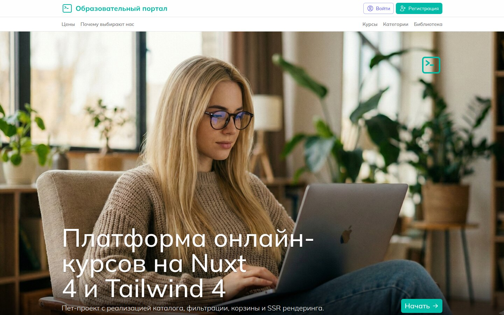
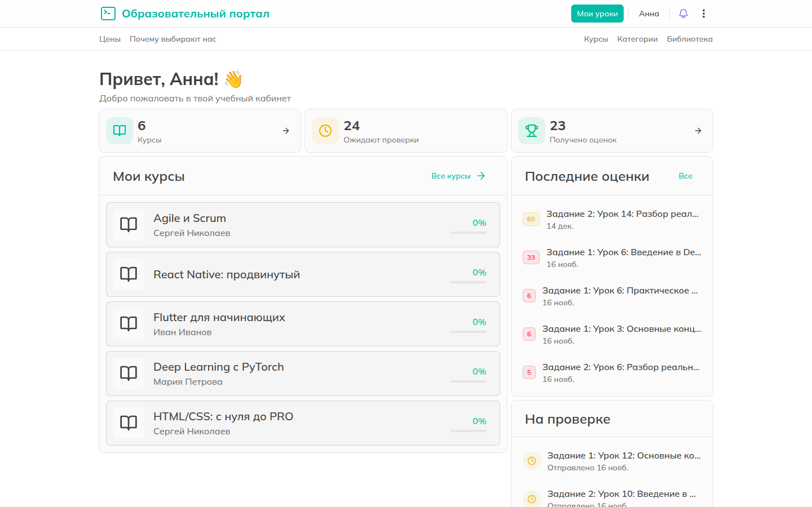
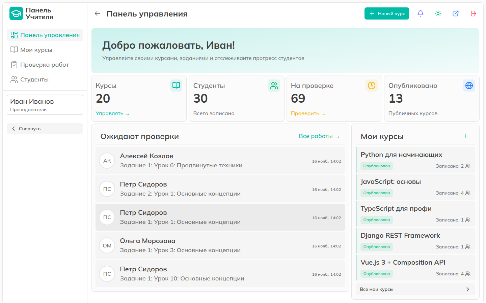
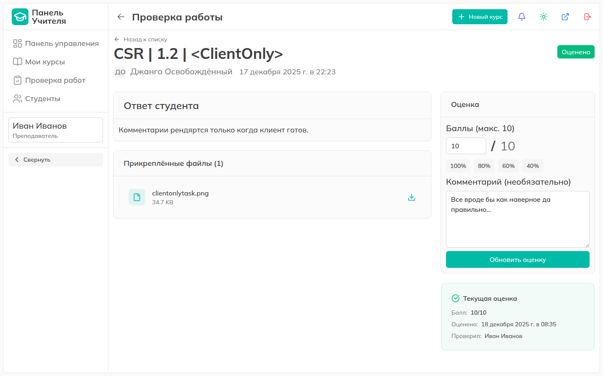
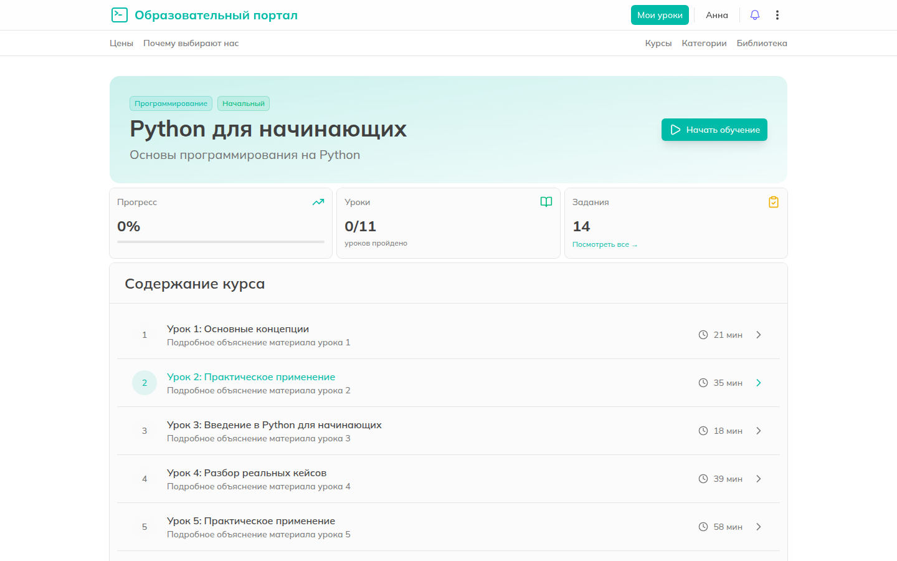

# Learning Platform — учебный портал (LMS)

Fullstack-платформа онлайн-обучения с двумя ролями: **студент** записывается на курсы,
проходит уроки, сдаёт задания и видит оценки; **преподаватель** создаёт курсы, уроки и
задания, проверяет работы и выставляет баллы.

**Стек:** Nuxt 4 · Vue 3.5 · TypeScript · Pinia · Nuxt UI 4 · Tailwind CSS 4 · Zod ·
Django 5.2 · Django REST Framework · SimpleJWT · Celery + Redis · SQLite · Docker · Nginx



| Кабинет студента | Панель преподавателя |
| :---: | :---: |
|  |  |
| **Проверка работы** | **Прохождение курса** |
|  |  |

Все экраны с описанием — в [screenshots/README.md](screenshots/README.md).

---

## Возможности

**Публичная часть**
- Каталог курсов с поиском, фильтрами (категория, сложность) и сортировкой.
- Страница курса: программа, описание, запись на курс.
- Регистрация и вход (тёмная и светлая темы).

**Студент**
- Дашборд: мои курсы, последние оценки, работы на проверке.
- Прохождение курса: содержание, прогресс, уроки с материалами.
- Задания: сдача ответа текстом и файлами, статусы «не сдано / на проверке / оценено», дедлайны.
- Журнал оценок со статистикой (средний, лучший, минимальный балл) и комментариями преподавателя.
- Комментарии к урокам (древовидные), профиль, настройки.

**Преподаватель**
- Панель: курсы, студенты, работы на проверке, опубликованные курсы.
- CRUD курсов, уроков и заданий; черновики и публикация.
- Очередь проверки с пагинацией и фильтром по статусу, выставление баллов с комментарием.

**Фоновые задачи (Celery)**
- Уведомления о новых заданиях, оценках, комментариях и входе в аккаунт.
- Напоминания о дедлайнах, очистка старых уведомлений и заблокированных JWT.

---

## Архитектура

```
Browser ──► Nuxt 4 (SSR) ──► Django REST API ──► SQLite
              │                    │
              │  HttpOnly cookies  └──► Celery worker / beat ──► Redis
              │  (access/refresh)
              └── server middleware: профиль пользователя при SSR, refresh токена
```

**Авторизация.** JWT (access + refresh) живут только в HttpOnly-cookies — JavaScript к
токенам доступа не имеет. В Pinia хранится только объект пользователя. При первой
загрузке Nitro-middleware получает профиль на сервере и гидрирует store, поэтому
защищённые страницы рендерятся без «мигания» гостевого состояния. Подробно —
[client/AUTH_SYSTEM.md](client/AUTH_SYSTEM.md).

**Фронтенд** разделён на слои:

| Слой | Где | Что делает |
| :--- | :--- | :--- |
| Pages | `app/pages/` | Маршруты; тонкие, собирают компоненты. |
| Components | `app/components/<feature>/` | UI, сгруппирован по фичам (learning, teacher, assignments…). |
| Composables | `app/composables/` | Загрузка данных и логика фич (`useAuth`, `useLessons`, `useTeacher`…). |
| Services | `app/services/` | Типизированные вызовы API, по одному на домен. |
| Schemas | `app/schemas/` | Zod-схемы форм и ответов API. |
| Middleware | `app/middleware/` | Доступ по ролям: `auth`, `guest`, `student-only`, `teacher-only`, `enrolled-course`. |

**Бэкенд** — Django-приложения по доменам:

| Приложение | Модели |
| :--- | :--- |
| `users` | `User` (роль student/teacher), `UserProfile` |
| `courses` | `Category`, `Course`, `CourseEnrollment`, `Lesson`, `LessonMaterial`, `Assignment`, `Submission`, `Grade` (+ файлы) |
| `core` | `Comment`, `Feedback`, `ActivityLog` |
| `notifications` | `Notification` |

Права доступа — через DRF permissions по ролям и владению объектом. Соглашения по коду —
[ARCHITECTURE.md](ARCHITECTURE.md), справочник эндпоинтов — [API.md](API.md).

---

## Запуск

### Docker Compose

```bash
cp server/.env.example server/.env
cp client/.env.example client/.env
docker compose up -d --build
docker compose exec backend python manage.py createsuperuser
```

| Сервис | Адрес |
| :--- | :--- |
| Приложение (через Nginx) | http://localhost |
| Nuxt напрямую | http://localhost:3000 |
| Django API | http://localhost:8000/api/ |
| Django Admin | http://localhost:8000/admin/ |
| Mailhog (письма) | http://localhost:8025 |

### Локально без Docker

Нужны Python 3.12, Node.js 20+, pnpm и Redis. Redis обязателен: вход в аккаунт ставит
задачу Celery, и без брокера запрос логина зависает.

```bash
# Redis
docker run -d --name redis -p 6379:6379 redis:7-alpine

# Backend → http://localhost:8000
cd server
python -m venv .venv && source .venv/bin/activate
pip install -r requirements.txt
echo "REDIS_URL=redis://localhost:6379/0" >> .env
python manage.py migrate
python manage.py createsuperuser
python manage.py runserver

# Celery (отдельные терминалы, по желанию)
celery -A config worker -l info
celery -A config beat -l info

# Frontend → http://localhost:3000
cd client
pnpm install
pnpm dev
```

Пользователей с ролями student/teacher удобно создать через страницу регистрации или
Django Admin.

### Переменные окружения backend

| Переменная | По умолчанию | Назначение |
| :--- | :--- | :--- |
| `DJANGO_SECRET_KEY` | dev-ключ | Секрет Django. Обязательно задать в проде. |
| `DEBUG` | `True` | Режим отладки. |
| `ALLOWED_HOSTS` | `localhost,127.0.0.1` | Разрешённые хосты. |
| `REDIS_URL` | `redis://redis:6379/0` | Брокер и backend результатов Celery. |
| `EMAIL_*`, `DEFAULT_FROM_EMAIL` | SMTP Gmail | Отправка писем-уведомлений. |

Фронтенд читает адрес API из `NUXT_PUBLIC_API_BASE` (по умолчанию `http://localhost:8000/api`).

### Тесты

```bash
cd server && python manage.py test     # или: make test (в Docker)
```

---

## Структура

```
├── client/               # Nuxt 4
│   ├── app/              # pages, components, composables, services, schemas, stores, middleware
│   └── server/           # Nitro middleware (SSR-авторизация)
├── server/               # Django
│   ├── config/           # settings, urls, celery
│   ├── users/ courses/ core/ notifications/
│   └── requirements.txt
├── nginx/                # reverse proxy
├── screenshots/          # скриншоты интерфейса
├── API.md                # справочник REST API
├── ARCHITECTURE.md       # соглашения по коду
└── docker-compose.yml
```
