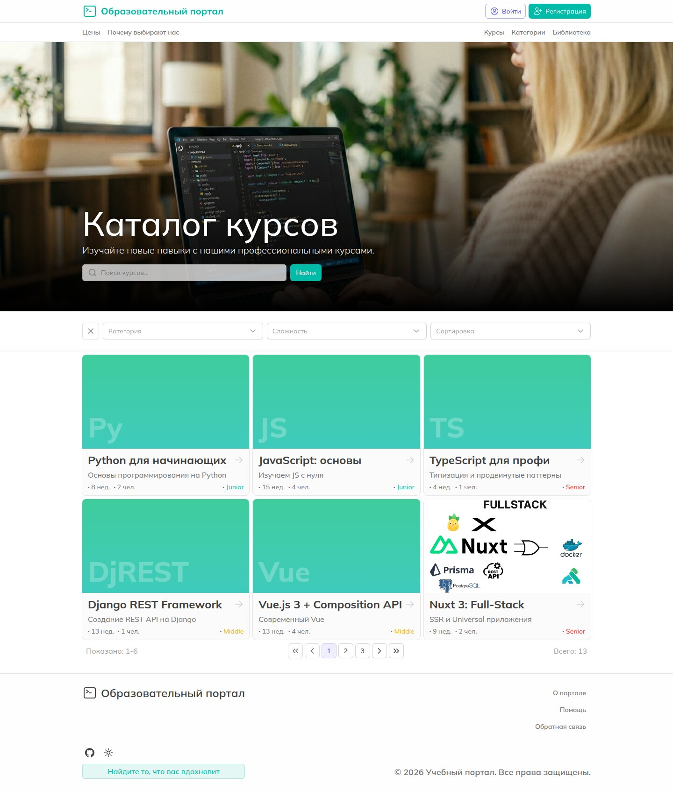
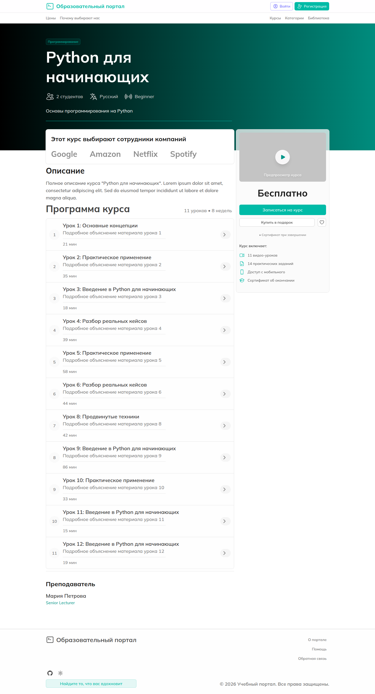
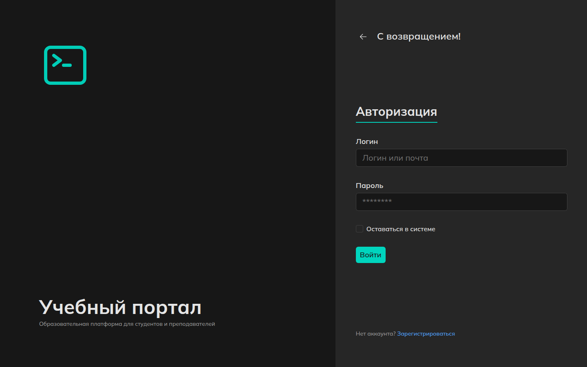
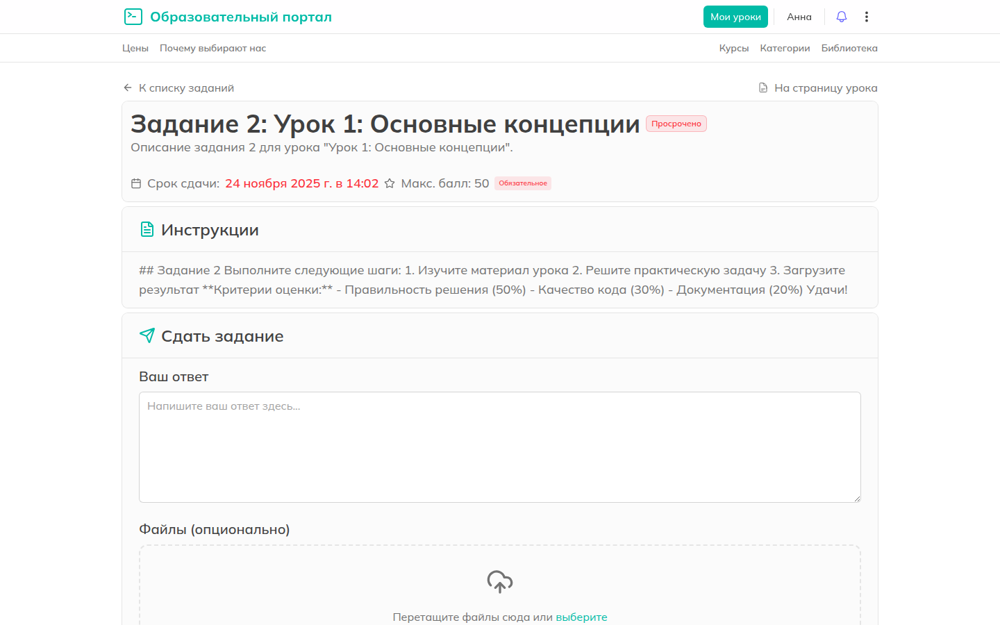
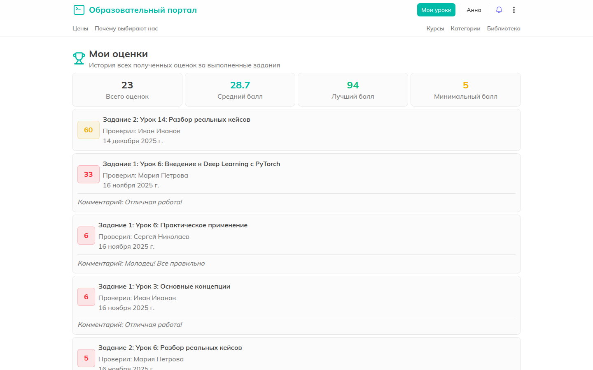
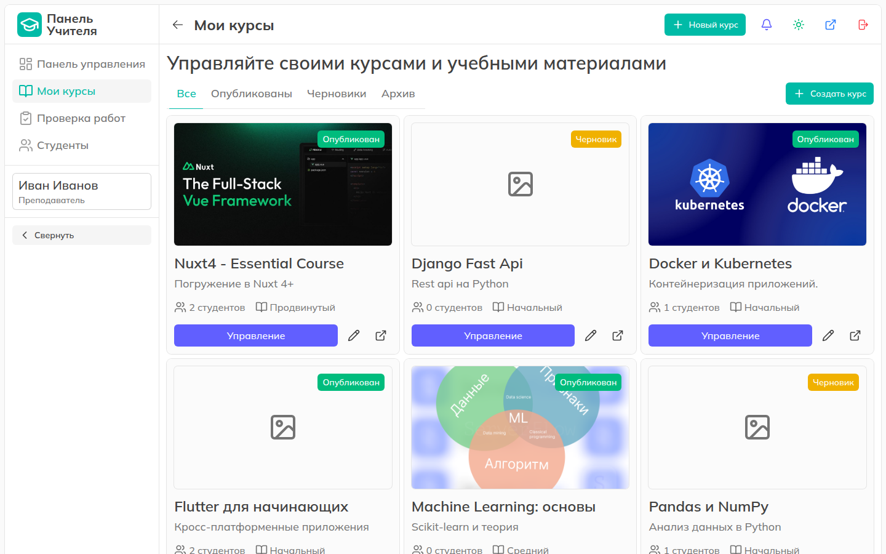
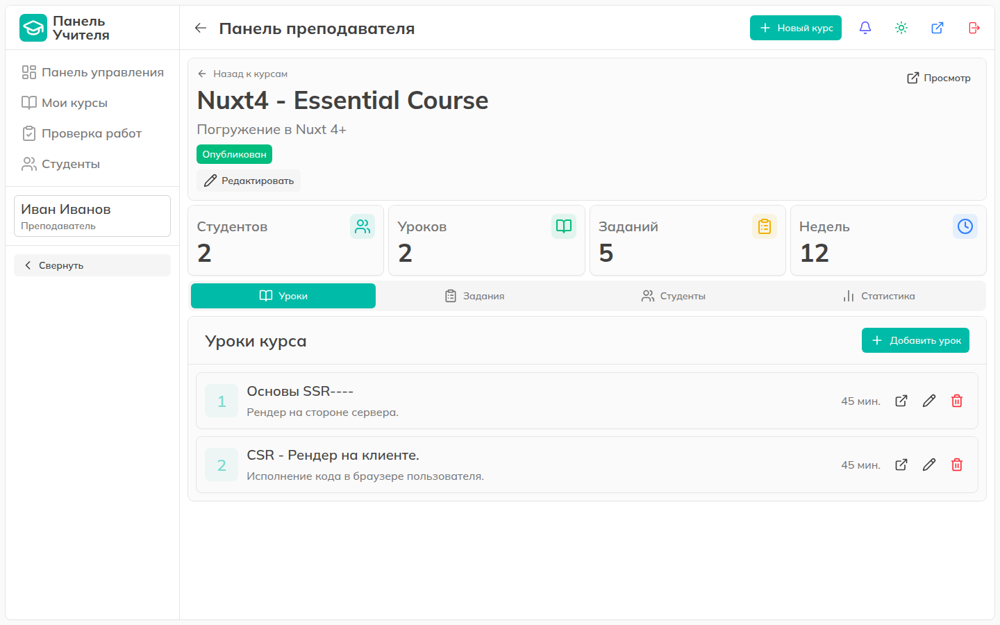
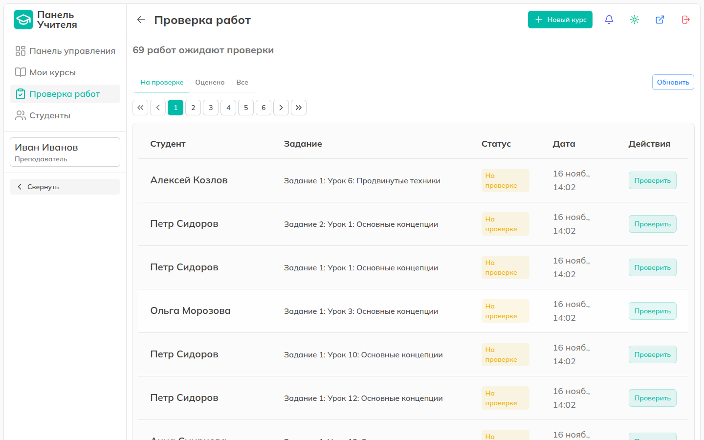
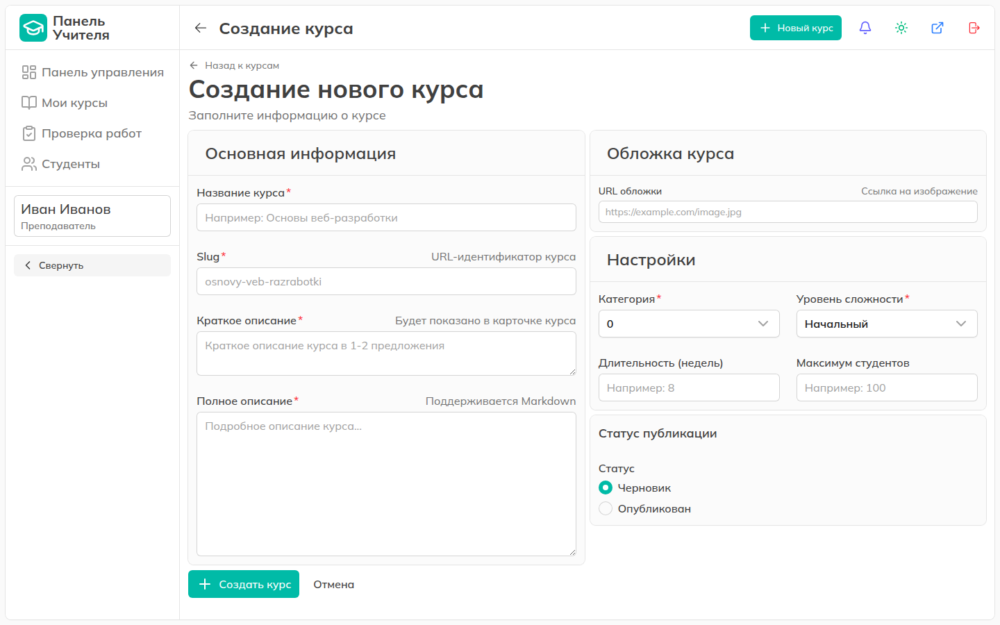

# Скриншоты

[← К README](../README.md)

## Публичная часть

**Главная страница**

**Каталог курсов** — поиск, фильтры по категории и сложности, сортировка.

**Страница курса** — описание, программа, запись на курс.

**Вход** — тёмная тема.

## Студент

**Дашборд** — мои курсы, последние оценки, работы на проверке.

**Прохождение курса** — прогресс и содержание.

**Задание** — инструкции, дедлайн, сдача ответа и файлов.

**Журнал оценок** — статистика и комментарии преподавателя.

## Преподаватель

**Панель управления** — сводка и очередь проверки.

**Мои курсы** — опубликованные, черновики, архив.

**Управление курсом** — уроки, задания, студенты, статистика.

**Проверка работ** — очередь с фильтром по статусу.

**Оценка работы** — ответ студента, файлы, баллы и комментарий.

**Создание курса**

